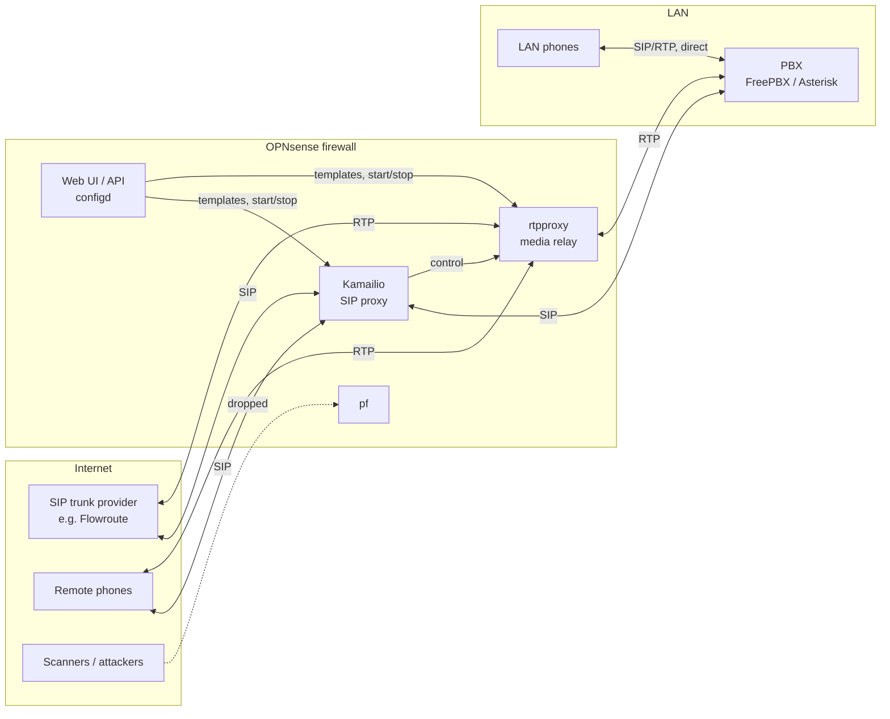
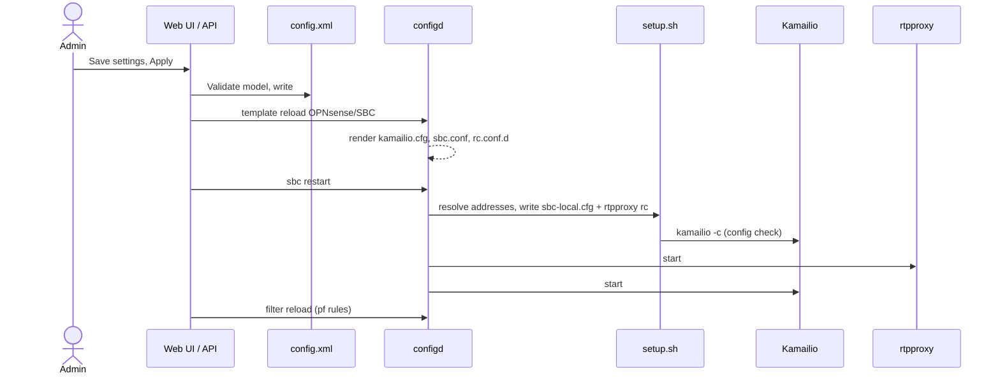

# ARC-SBC-0001: os-SBC architecture overview

> **In short:** Kamailio and rtpproxy run on the firewall. Trunks and remote phones talk to the firewall, and the firewall talks to the PBX, so the PBX is never exposed to the internet. This page shows the pieces, the ports and how data flows.

Detail lives in [DES-SBC-0001](design/DES-SBC-0001-kamailio-routing.md) and the [ADRs](adr/README.md).

## What it is

os-SBC is an OPNsense plugin. It runs **Kamailio** (SIP signalling) and
**rtpproxy** (media relay) on the firewall, so the PBX on the LAN is never
exposed to the internet. Trunks and remote phones talk to the firewall; the
firewall talks to the PBX.

## Context

LAN phones keep talking to the PBX directly. Only traffic crossing the WAN
goes through the SBC.

## Components

| Component | Runs as | Role |
|---|---|---|
| **Kamailio 6.1** | `kamailio` user, `/usr/local/etc/rc.d/kamailio` | Stateful SIP proxy. Classifies traffic (trunk, remote phone, PBX), forwards it, adds Path for registrations, tracks dialogs, drives the media relay. Never a registrar or B2BUA (ADR-SBC-0008). |
| **rtpproxy 3.1** | `rtpproxy` user, `/usr/local/etc/rc.d/rtpproxy` | Bridge-mode media relay: one address on the LAN, one on the WAN. Allocates a port pair per call, frees it at the end. |
| **Remote rtpengine** (optional) | separate Linux host | Replaces rtpproxy when transcoding, SRTP termination or WebRTC is needed (later). |
| **Plugin MVC** | PHP in OPNsense's web stack | Model (`OPNsense/SBC`), settings and live-call pages, REST API under `/api/sbc/`. |
| **configd actions** | root, via configd | `sbc start/stop/restart/reload/status`, `sbc calls`, `sbc stats`. |
| **Templates** | rendered by configd | `kamailio.cfg`, `sbc.conf`, `rc.conf.d` entries. |
| **setup.sh** | root, before each start and at boot | Resolves interface addresses (or the CARP VIP), writes `sbc-local.cfg` and rtpproxy's rc settings. |
| **plugins.inc.d/sbc.inc** | OPNsense core hooks | Service registration, automatic pf rules, HA config sync. |

## Interfaces and ports (defaults)

| Where | Port | Protocol | Purpose |
|---|---|---|---|
| WAN address (or VIP) | 5060 | UDP, TCP | SIP from trunks and remote phones |
| WAN address (or VIP) | 5061 | TLS | SIP over TLS (beta.1, optional) |
| WAN address (or VIP) | 10000–20000 | UDP | Media relay range. Only ports allocated to a live call answer. |
| LAN address | 5060 | UDP, TCP | SIP to and from the PBX |
| LAN address | 10000–20000 | UDP | Media relay range, PBX side |
| 127.0.0.1 | 7722 | UDP | rtpproxy control (Kamailio only) |
| `/var/run/kamailio/` | FIFO | — | Kamailio JSON-RPC for the live-call page |

The plugin adds pf rules for the WAN-side SIP ports and the relay range, to
*this firewall* only (ADR-SBC-0003). It never forwards ports to the PBX.

## Configuration flow

A config that fails `kamailio -c` is not started, and the UI shows the error
(FR-SBC-SVC-0002).

## Live data flow

The live-call page polls `/api/sbc/service/calls` every few seconds. The API
runs the configd action, which asks Kamailio over its JSON-RPC FIFO (dialogs,
statistics) and rtpproxy over its control socket (active sessions), and
returns JSON. Nothing is stored; it is a live view.

## HA (beta.1)

- Settings sync to the backup firewall through OPNsense's XMLRPC sync.
- Kamailio and rtpproxy listen on the CARP VIP, so after failover the backup
  answers on the same addresses.
- Calls in progress drop on failover in 1.0. Call-state replication (Kamailio
  `dmq`) is in the parking lot.

## Packaging

The plugin, Kamailio, rtpproxy and any libraries OPNsense lacks come from the
KSA package repository (ADR-SBC-0006). The plugin package depends on `kamailio`
and `rtpproxy`, so installing `os-sbc` from the plugin list pulls in both.
