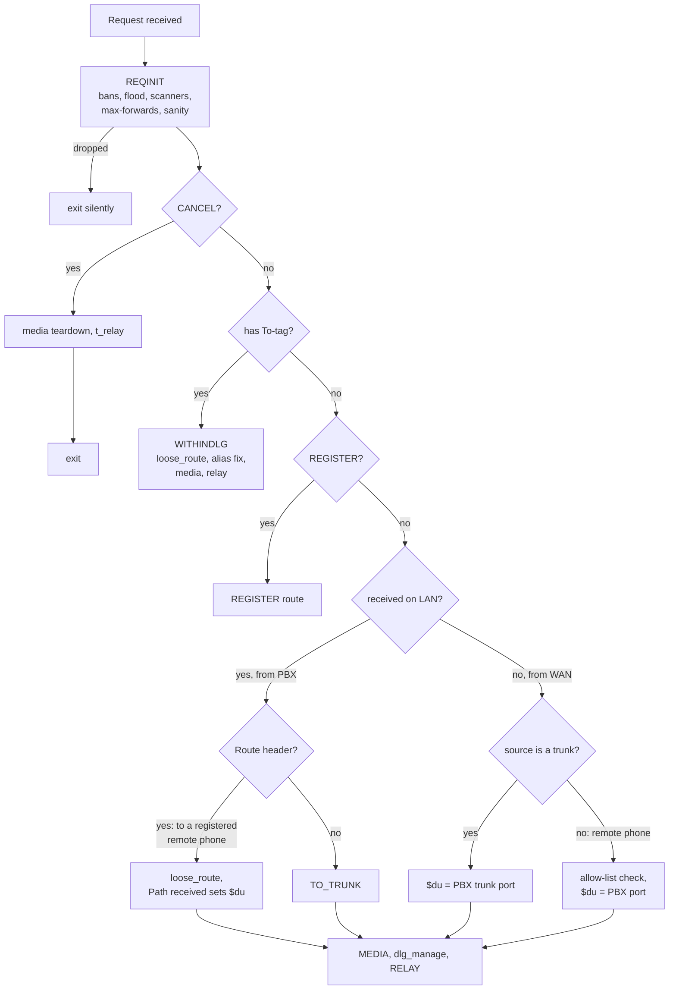
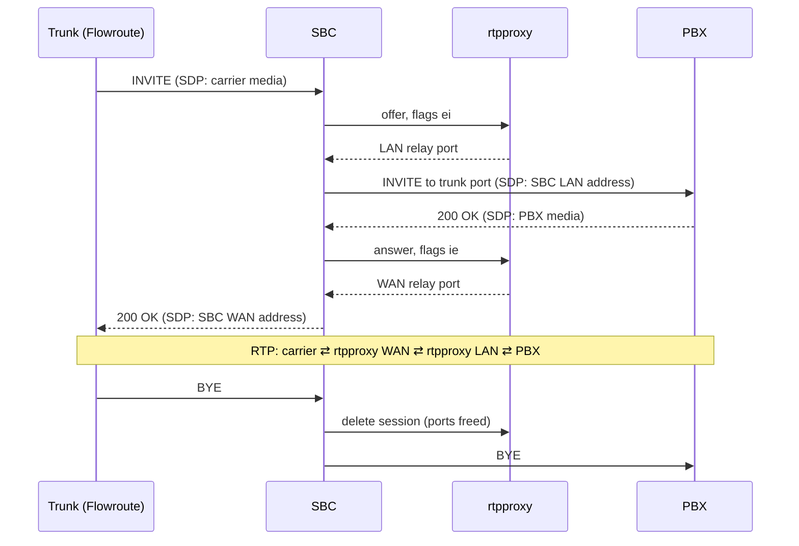

# Design 0001: Kamailio routing and media handling

**Status**: Draft
**Date**: 2026-11-26
**Owner**: Kevin Adams
**Delivers**: FR-NET-1/2/3, FR-PBX-1, FR-TRK-1/2, FR-REG-1/2, FR-MEDIA-1/2/3, FR-SEC-1/2/3
**Related**: ADR-0002, ADR-0003, ADR-0008, [architecture.md](../architecture.md),
[threat model](../security/threat-model.md)

How the generated `kamailio.cfg` decides where every SIP message goes, and
when media is relayed. Items marked **[verify]** are assumptions to confirm
in the lab before alpha.1 code is merged.

## 1. Principles

1. **Direction comes from the receiving socket.** A message received on the
   LAN address came from the PBX side; anything else came from the WAN. In
   Kamailio this is `$Ri` (received IP). No guessing from headers.
2. **The SBC never routes WAN to WAN.** Everything from the WAN goes to the
   PBX. Only the PBX can send to a trunk or a remote phone. This single rule
   is the main defence against toll fraud and open-relay abuse.
3. **The PBX is the only registrar and the only place that authenticates**
   (ADR-0008).
4. **Stateful, record-routed.** `tm` for transactions, `record_route()` on
   dialog-creating requests so in-dialog requests come back through the SBC,
   `dialog` for the live view and limits.
5. **Media for every call**, in both directions (ADR-0003).

## 2. Generated files

| File | Written by | Contents |
|---|---|---|
| `/usr/local/etc/kamailio/kamailio.cfg` | configd template | Modules, parameters, routes. PBX, trunks and options come from the model. |
| `/usr/local/etc/kamailio/sbc-local.cfg` | `setup.sh` at each start | `#!substdef` values for addresses only known at runtime: `SBC_WAN_IP`, `SBC_WAN_ADV`, `SBC_LAN_IP`. |
| `/usr/local/etc/sbc/sbc.conf` | configd template | Shell variables for `setup.sh`: physical interface names, RTP range, media engine. |
| `/etc/rc.conf.d/kamailio` | configd template | `kamailio_enable`, `kamailio_setup` (runs `setup.sh` at boot). |
| `/etc/rc.conf.d/rtpproxy` | `setup.sh` | `rtpproxy_enable`, addresses, control socket, `rtpproxy_flags` (port range, logging). |

Addresses are resolved at start rather than templated, because WAN addresses
can come from DHCP or PPPoE. `setup.sh` takes the first IPv4 address of the
chosen interface, or the chosen CARP VIP (beta.1).

## 3. Listeners

```
listen=udp:SBC_WAN_IP:5060 advertise SBC_WAN_ADV:5060
listen=tcp:SBC_WAN_IP:5060 advertise SBC_WAN_ADV:5060   # if TCP enabled
listen=udp:SBC_LAN_IP:5060
listen=tcp:SBC_LAN_IP:5060                              # if TCP enabled
mhomed=1          # pick the outgoing socket by route
auto_aliases=no
alias=SBC_WAN_ADV # so uri==myself matches the advertised address
```

`SBC_WAN_ADV` equals `SBC_WAN_IP` unless an advertised address is set
(FR-NET-2, double NAT). `#!substdef` is used instead of `#!define` because the
values sit inside `listen=` strings and quoted comparisons. **[verify]**

## 4. Request routing



### 4.1 REQINIT (all requests)

For traffic received on the WAN only:

- Drop sources in the ban table (`htable` `ipban`, auto-expiring).
- Flood check with `pike`; a source over the limit is added to `ipban`
  (FR-SEC-1).
- Drop known scanner user agents silently (FR-SEC-2). Silent drop gives
  scanners nothing to learn from.

For all traffic: `maxfwd` check (483), `sanity_check`, and answer
`OPTIONS` addressed to the SBC itself with 200 (trunk keepalives).

### 4.2 Within-dialog requests (To-tag present)

- `loose_route()`. If it succeeds: `handle_ruri_alias()` (restores the NAT
  address of a remote phone), MEDIA for INVITE/UPDATE/ACK/BYE, then RELAY.
- ACK without a route: relay only if it matches a transaction.
- Otherwise 404 and stop.

### 4.3 REGISTER (FR-REG-1)

- Only accepted on the WAN side. A REGISTER received on the LAN gets 403.
- Optional allow-list of phone source networks (FR-SEC-3).
- `add_path_received()` adds `Path: <sip:SBC_LAN_IP;lr;received=sip:<src>:<port>>`.
- `$du` = the PBX, then relay. The PBX authenticates (401/407 pass back to the
  phone unchanged).
- The registration-failure counter from the threat model (T-3) hooks the
  replies here.

### 4.4 Initial requests from the WAN

1. **Trunk check:** the source IP matches an enabled trunk's address or one of
   its inbound networks (`ipops` `is_in_subnet`). Trunks given as hostnames
   need inbound networks, because `$si` is an IP. **[verify]** whether to
   resolve hostnames at template time instead.
2. **From a trunk:** `$du` = PBX at the trunk port (ADR-0008), so the PBX can
   tell carrier calls from phone calls.
3. **Not a trunk** (a remote phone): allow-list check, `$du` = PBX at the
   phone port. The PBX challenges the INVITE.
4. Strip any `Route` headers the caller pre-loaded. WAN requests are never
   source-routed.

### 4.5 Initial requests from the LAN (the PBX)

1. **Has a Route header** (a call to a registered remote phone, using the Path
   the PBX stored): `loose_route()` consumes our own Route; the `path` module's
   `use_received` sets `$du` to the phone's NAT address.
2. **No Route header:** TO_TRUNK.
   - If the R-URI host is a configured trunk address, send it there.
   - If the R-URI host is the SBC's LAN address, use the first enabled trunk
     (the default trunk) and rewrite the host to it.
   - No trunk: 404.

### 4.6 RELAY

Arms `t_on_reply("MANAGE_REPLY")` and, for INVITE, `t_on_failure("MANAGE_FAILURE")`,
then `t_relay()`; on failure `sl_reply_error()`.

## 5. Media handling (FR-MEDIA-1)

rtpproxy runs in bridge mode with **the LAN address first and the WAN address
second**: `-l LAN/WAN -A LAN/WAN_ADV`. Kamailio's direction flags follow
rtpproxy's interface order (`i` = first, `e` = second). **[verify]** that the
flags refer to the direction of the message being handled in replies as well
as requests.

| Message received on | Sent towards | rtpproxy flags | rtpengine (remote) flags |
|---|---|---|---|
| WAN | LAN | `ei` | `direction=external direction=internal` |
| LAN | WAN | `ie` | `direction=internal direction=external` |

Where it is called:

| Point | Call |
|---|---|
| INVITE, re-INVITE, UPDATE, ACK with SDP | `rtpproxy_manage("<flags>")`: offer or answer |
| Replies with SDP (183, 200) | `rtpproxy_manage("<flags>")` in `MANAGE_REPLY` |
| BYE, CANCEL | `rtpproxy_manage()`: deletes the session |
| Negative final reply to INVITE | `rtpproxy_destroy()` in `MANAGE_FAILURE` |
| Lost BYE / dead call | rtpproxy media timeout frees the ports by itself |

rtpproxy's control socket is UDP on 127.0.0.1:7722 rather than a Unix socket,
to avoid file permission problems between the `rtpproxy` and `kamailio` users.

## 6. NAT handling for remote phones (FR-REG-2)

- `force_rport()` on WAN requests.
- `nat_uac_test("19")` (private Contact, Via received ≠ source, port
  mismatch). If true on an initial request or a reply from the WAN,
  `set_contact_alias()` adds the real address to the Contact, so in-dialog
  requests from the PBX reach the phone. `handle_ruri_alias()` undoes it on
  the way out (4.2).
- Registered phones are reached through Path (4.5). Keepalive is the phone's
  or the PBX's job in 1.0 (ADR-0008).
- Trunk providers have public addresses, so the NAT test is false and nothing
  is rewritten.

## 7. Dialog tracking and live data (FR-MON-1/2)

- `dlg_manage()` on initial INVITE. The dialog module counts active calls and
  exposes `dlg.list`.
- `jsonrpcs` with a FIFO in `/var/run/kamailio/`. A small Python helper run
  by configd sends `dlg.list` and `stats.get_statistics`, reads the reply FIFO,
  and adds rtpproxy's session counts from its control socket.
- Dialog default timeout: 6 hours, so a call that never sees a BYE does not
  stay in the live view forever.

## 8. Firewall rules (FR-MEDIA-2)

Registered through the plugin's `sbc_firewall()` hook, for each external
interface, when automatic rules are enabled:

- pass UDP and TCP to (self) on the SIP port, from any source or from the
  allow-list plus trunk networks;
- pass UDP to (self) on the relay range, from any source.

No rules for the LAN side; OPNsense's LAN defaults already allow it. **[verify]**
the exact `registerFilterRule()` fields on OPNsense 26.7.

## 9. Call flows

### 9.1 Remote phone registers

```mermaid
sequenceDiagram
    participant P as Remote phone (NAT)
    participant S as SBC (Kamailio)
    participant X as PBX
    P->>S: REGISTER (Contact: private IP)
    S->>X: REGISTER + Path: <sip:LAN_IP;lr;received=sip:public:port>
    X-->>S: 401 Unauthorized
    S-->>P: 401
    P->>S: REGISTER + Authorization
    S->>X: REGISTER + Path
    X-->>S: 200 OK
    S-->>P: 200 OK
```

### 9.2 Inbound carrier call to a LAN extension



### 9.3 PBX calls a registered remote phone

The PBX sends INVITE with `Route: <sip:LAN_IP;lr;received=...>` from the stored
Path. Kamailio consumes the Route, sends to the phone's NAT address, relays
media with `ie` on the request and `ei` on the reply.

## 10. Open items before implementation

1. **[verify]** `#!substdef` inside `listen=` and quoted comparisons.
2. **[verify]** rtpproxy bridge flag semantics in replies.
3. **[verify]** `registerFilterRule()` fields on OPNsense 26.7.
4. **[verify]** `add_path_received()` uses the LAN socket when forwarding to the PBX with `mhomed=1`.
5. Decide: trunk hostnames resolved at template time, or require IPs/networks.
6. Decide: separate PBX port for trunk traffic (current plan) vs a header (PRD open question 3).
7. Confirm the Asterisk PJSIP settings for Path (`support_path=yes` on the AoR and endpoint) in the FreePBX lab.
