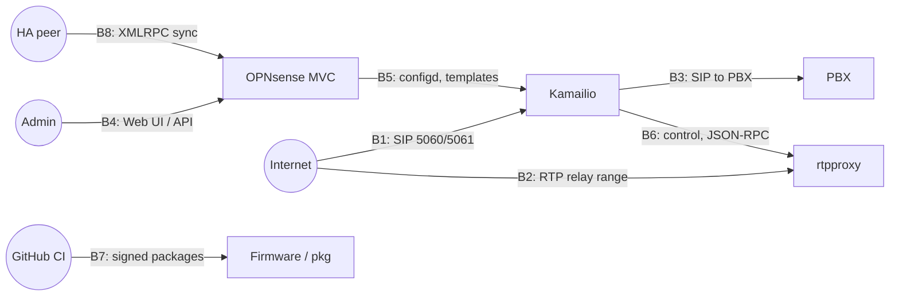

# TM-SBC-0001: os-sbc threat model

> **In short:** An SBC faces the internet by design, so this lists what an
> attacker (or an accident) could do to it, what stops each one, and what
> risk is left. The four biggest: password guessing the PBX can't see,
> toll fraud through an open relay, audio hijacking at the relay, and
> settings that inject commands into the generated config.

## What we are protecting

| Asset | Why it matters |
|---|---|
| Calls through the trunk | **Toll fraud** is the classic VoIP loss, often thousands of dollars in a weekend |
| PBX extension passwords | Lead straight to toll fraud and eavesdropping |
| Call audio and metadata | Privacy; may be regulated |
| Being able to make calls at all | Phones are often a business's front door, and carry emergency calls |
| The firewall itself | os-sbc runs on the box that protects the whole network |
| The package signing key | Whoever holds it can push code to every install |
| The Flowroute test account | Toll fraud against our own account |

## Where the trust boundaries are



| Boundary | In plain words |
|---|---|
| B1 | Anyone on the internet can send SIP to the firewall. |
| B2 | Anyone can send packets at the relay's port range. |
| B3 | The SBC hands traffic to the PBX, which may trust it too much. |
| B4, B5 | Admin settings become config files and service restarts. |
| B6 | Kamailio and rtpproxy control each other locally. |
| B7 | Packages travel from CI to every firewall. |
| B8 | The HA pair push settings to each other. |

## The biggest risks, in plain words

1. **Password guessing the PBX can't see** (THR-SBC-0003). Every guess
   reaches the PBX from the SBC's own address, so the PBX's fail2ban can't
   ban the real attacker. The SBC has to count failed logins per source and
   ban them itself. This should be done before anything faces the internet.
2. **Toll fraud through an open relay** (THR-SBC-0001). Stopped by one design
   rule: traffic from the internet only ever goes to the PBX. Its test is a
   release blocker.
3. **Audio hijacking at the relay, "RTP bleed"** (THR-SBC-0010). We don't yet
   know how rtpproxy behaves here; it needs a lab test.
4. **Settings that inject config** (THR-SBC-0015). Every field needs strict
   validation, and the tests feed it hostile input.

Testing on the production HA backup carries its own risk (THR-SBC-0022,
THR-SBC-0024); [RB-SBC-0002](../runbooks/RB-SBC-0002-prepare-ha-backup-for-testing.md)
is the procedure that keeps it safe.

The requirements this model asked for (FR-SBC-SEC-0006 to 0010, NFR-SBC-0007
and 0008) are in PRD-SBC-0001. New ones go under `proposed_requirements` in
the machine-readable section until the PRD takes them.

Revisit this document when a trust boundary changes (TLS, rtpengine, call
state replication, CDRs) and before every major release.

## Machine-readable

Authoritative threat register. STRIDE letters: S spoofing, T tampering, R
repudiation, I information disclosure, D denial of service, E elevation of
privilege. Residual risk: `low`, `medium`, `high`, `unknown`.

```yaml
threats:
  # B1: SIP from the internet
  - id: THR-SBC-0001
    boundary: B1
    stride: [E]
    title: "Toll fraud by open relay: INVITE to the SBC aimed at the carrier"
    mitigation: "Design rule: WAN traffic only ever goes to the PBX, never to a trunk (DES-SBC-0001 §1)."
    requirements: []
    tests: [I-NEG-1]
    residual: low
    note: "A regression would be severe, so I-NEG-1 blocks releases."
  - id: THR-SBC-0002
    boundary: B1
    stride: [S]
    title: "Spoofed trunk source: forged UDP from the carrier's address"
    mitigation: "Trunk traffic only reaches the PBX trunk port; the PBX trunk context routes to DIDs only. TCP/TLS trunks cannot be spoofed blind."
    requirements: [FR-SBC-PBX-0001]
    tests: [I-TRK-1]
    residual: medium
    note: "Document that the PBX trunk context must not allow outbound dialling."
  - id: THR-SBC-0003
    boundary: B1
    stride: [S, E]
    title: "Password guessing via REGISTER/INVITE, invisible to the PBX's own bans"
    mitigation: "SBC counts 401/403 replies from the PBX per WAN source and bans repeat offenders."
    requirements: [FR-SBC-SEC-0006]
    tests: [S-3]
    residual: high
    note: "High until FR-SBC-SEC-0006 ships (alpha.1); low after."
  - id: THR-SBC-0004
    boundary: B1
    stride: [D]
    title: "Flood of REGISTER, INVITE or OPTIONS"
    mitigation: "pike rate limit plus temporary bans; pf state limits."
    requirements: [FR-SBC-SEC-0001]
    tests: [S-1]
    residual: medium
    note: "A large distributed flood still saturates the WAN link."
  - id: THR-SBC-0005
    boundary: B1
    stride: [I]
    title: "Scanning and fingerprinting"
    mitigation: "Silent drop for scanner user agents; generic Server/User-Agent headers."
    requirements: [FR-SBC-SEC-0002]
    tests: [S-2]
    residual: low
  - id: THR-SBC-0006
    boundary: B1
    stride: [I]
    title: "Internal addresses leak to the carrier in Via, Contact or SDP"
    mitigation: "Topology hiding (topos)."
    requirements: [FR-SBC-SEC-0004]
    tests: [I-SEC-2]
    residual: medium
    note: "Until beta.1, document the leak."
  - id: THR-SBC-0007
    boundary: B1
    stride: [T]
    title: "Malformed SIP exploiting a parser bug"
    mitigation: "sanity_check; Kamailio kept current through the deps pipeline; security fixes ship as patch releases."
    requirements: []
    tests: []
    residual: medium
  - id: THR-SBC-0008
    boundary: B1
    stride: [E]
    title: "Pre-loaded Route headers used to bounce traffic through the SBC"
    mitigation: "Route stripped on initial WAN requests (DES-SBC-0001 §4.4)."
    requirements: []
    tests: [I-NEG-3]
    residual: low
  - id: THR-SBC-0009
    boundary: B1
    stride: [I]
    title: "Eavesdropping on signalling"
    mitigation: "SIP over TLS on the WAN side."
    requirements: [FR-SBC-SEC-0005]
    tests: [I-SEC-3]
    residual: high
    note: "Same as today's plain-UDP setups until TLS ships."

  # B2: RTP relay range
  - id: THR-SBC-0010
    boundary: B2
    stride: [I, T]
    title: "RTP injection or RTP bleed: the relay learns an attacker's address"
    mitigation: "Ports exist only during calls (ADR-SBC-0003); lock latching to the negotiated peer if the engine supports it."
    requirements: [FR-SBC-SEC-0009]
    tests: [S-5]
    residual: unknown
    note: "Known class of SBC bug; needs a lab test before beta.1."
  - id: THR-SBC-0011
    boundary: B2
    stride: [D]
    title: "Port exhaustion: many fake calls hold relay ports"
    mitigation: "Calls start only after the PBX accepts them; per-source dialog limit; media timeout."
    requirements: [FR-SBC-SEC-0008]
    tests: [S-4]
    residual: medium
  - id: THR-SBC-0012
    boundary: B2
    stride: [D]
    title: "Bandwidth abuse through the relay"
    mitigation: "Relay only forwards between the two negotiated endpoints."
    requirements: [FR-SBC-MEDIA-0001]
    tests: [I-MED-1]
    residual: low

  # B3: SBC to PBX
  - id: THR-SBC-0013
    boundary: B3
    stride: [E]
    title: "PBX trusts the SBC's address and skips authentication"
    mitigation: "Docs: the PBX authenticates phone traffic from the SBC and allows only DID routing on the trunk port (ADR-SBC-0008)."
    requirements: [FR-SBC-REG-0001]
    tests: [I-REG-1]
    residual: medium
    note: "A PBX config mistake we can only document."
  - id: THR-SBC-0014
    boundary: B3
    stride: [S]
    title: "A LAN host pretends to be the PBX"
    mitigation: "REGISTER refused from the LAN; LAN-side requests accepted only from the configured PBX address."
    requirements: [FR-SBC-SEC-0007]
    tests: [I-NEG-2, I-SEC-4]
    residual: low

  # B4/B5: admin UI, API, configd, templates
  - id: THR-SBC-0015
    boundary: B5
    stride: [T, E]
    title: "Config injection: a field value breaks out into kamailio.cfg or sbc.conf"
    mitigation: "Masks on every text field, typed fields for addresses and ports, quoted shell values, hostile-input template tests."
    requirements: [NFR-SBC-0007]
    tests: [T-CFG-6]
    residual: low
    note: "High without the tests."
  - id: THR-SBC-0016
    boundary: B4
    stride: [E]
    title: "Unprivileged OPNsense user changes SBC settings"
    mitigation: "ACL page-services-sbc; separate read-only ACL for the live-call page."
    requirements: [FR-SBC-SEC-0010]
    tests: [I-MON-4]
    residual: low
  - id: THR-SBC-0017
    boundary: B4
    stride: [I]
    title: "Live-call page shows phone numbers to users who should not see them"
    mitigation: "Read-only ACL; no call history stored in 1.0."
    requirements: [FR-SBC-SEC-0010]
    tests: [I-MON-4]
    residual: low

  # B6: Kamailio and rtpproxy control
  - id: THR-SBC-0018
    boundary: B6
    stride: [T]
    title: "Another local process controls rtpproxy or Kamailio"
    mitigation: "rtpproxy control on 127.0.0.1 only; JSON-RPC FIFO in /var/run/kamailio (0750)."
    requirements: []
    tests: []
    residual: low

  # B7: package supply chain
  - id: THR-SBC-0019
    boundary: B7
    stride: [T, E]
    title: "Stolen signing key pushes malicious packages"
    mitigation: "Key only in a protected GitHub environment with required approval; rotation runbook."
    requirements: [NFR-SBC-0008]
    tests: [L-DOC-1]
    residual: medium
    note: "GitHub account compromise remains a single point; consider hardware-backed signing later."
  - id: THR-SBC-0020
    boundary: B7
    stride: [T]
    title: "Compromised dependency or CI action"
    mitigation: "Actions pinned to SHAs; Dependabot; deps built from opnsense/ports at pinned commits."
    requirements: []
    tests: [L-ALL]
    residual: medium
  - id: THR-SBC-0021
    boundary: B7
    stride: [E]
    title: "Our repository overrides an OPNsense package"
    mitigation: "Lower priority than the OPNsense repository; ship only packages OPNsense lacks (ADR-SBC-0006)."
    requirements: [FR-SBC-PKG-0001]
    tests: [I-PKG-1]
    residual: low

  # B8: HA sync and testing on the HA pair
  - id: THR-SBC-0022
    boundary: B8
    stride: [T]
    title: "Primary pushes its settings over the backup's test settings during a test"
    mitigation: "Turn off config sync on the primary before testing (RB-SBC-0002)."
    requirements: []
    tests: []
    residual: low
  - id: THR-SBC-0024
    boundary: B8
    stride: [D]
    title: "Testing on the production HA backup disrupts production"
    mitigation: "CARP left running so production still fails over; the test SBC binds only to the backup's own addresses, never CARP VIPs; devel packages removed and sync restored afterwards (RB-SBC-0002)."
    requirements: []
    tests: []
    residual: medium
    note: "While sync is off, a failover runs on the last synced config, so production changes are frozen for the test window."

  - id: THR-SBC-0025
    boundary: B7
    stride: [T, D]
    title: "Orphaned FreeBSD ports: rtpproxy, bcg729 and gsm have no ports maintainer"
    mitigation: "We build from opnsense/ports at a pinned release (ADR-SBC-0010) and can carry a port ourselves if FreeBSD drops it; rtpproxy itself is maintained upstream (Sippy)."
    requirements: []
    tests: []
    residual: medium
    note: "Watch the ports at each OPNsense release bump; security fixes may arrive late or not at all without a maintainer."

  # Secrets in development
  - id: THR-SBC-0023
    boundary: B7
    stride: [I]
    title: "Flowroute credentials, phone numbers or SIP traces with credentials end up in the repo, issues or logs"
    mitigation: "gitleaks in CI; fixtures use documentation addresses; bug template asks for redaction; credentials only in the PBX and protected CI environments."
    requirements: []
    tests: [L-ALL]
    residual: low

proposed_requirements: []   # all moved into PRD-SBC-0001 on 2026-11-27 (#8)
```
