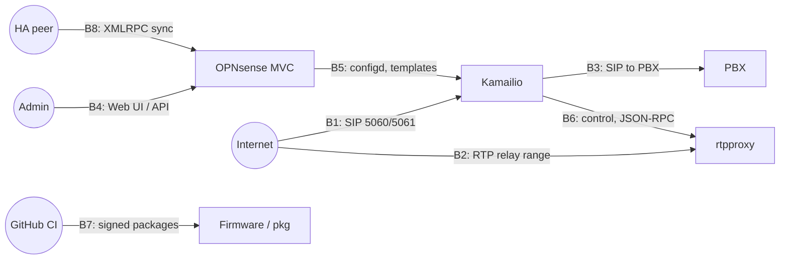

# os-sbc threat model

**Status**: Draft
**Date**: 2026-11-26
**Method**: STRIDE per trust boundary
**Related**: PRD-0001 (FR-SEC-*), ADR-0003, ADR-0006, ADR-0008,
[design/0001-kamailio-routing.md](../design/0001-kamailio-routing.md)

An SBC faces the internet by design. This document lists what could go wrong,
what stops it, and what risk is left. Mitigations marked **(new)** are not
yet in PRD-0001; section 5 proposes adding them.

## 1. Assets

| Asset | Why it matters |
|---|---|
| Ability to place calls through the trunk | **Toll fraud** is the classic VoIP loss, often thousands of dollars in a weekend |
| PBX credentials (extension passwords) | Lead directly to toll fraud and eavesdropping |
| Call audio and metadata | Privacy; may be regulated |
| Availability of calls | Phones are often a business's front door; 911 calls |
| The firewall itself | os-sbc runs on the box that protects the whole network |
| Package signing key | Whoever holds it can push code to every install |
| Flowroute account credentials | Toll fraud against the test account |

## 2. Trust boundaries

## 3. Threats and mitigations

### B1 — SIP from the internet

| # | STRIDE | Threat | Mitigation | Residual |
|---|---|---|---|---|
| T-1 | E | **Toll fraud by open relay**: attacker sends INVITE to the SBC aimed at the carrier | Design rule: WAN traffic only ever goes to the PBX, never to a trunk (design §1.2). Test I-NEG-1. | Low, if the rule holds. A regression would be severe, so I-NEG-1 is a release blocker. |
| T-2 | S | **Spoofed trunk source**: forged UDP from the carrier's IP to skip phone checks | Trunk traffic still only reaches the PBX's trunk port; the PBX's inbound context should only route to DIDs. TCP/TLS trunks cannot be spoofed blind. | Medium for UDP. Document: PBX trunk context must not allow outbound dialing. |
| T-3 | S, E | **Password guessing via REGISTER/INVITE**: the PBX sees every attempt from the SBC's LAN address, so its own fail2ban cannot ban the real source | **(new)** SBC counts 401/403 replies from the PBX per WAN source and bans repeat offenders (`htable`). | Low once added. Without it, **high**: this is the most important new item. |
| T-4 | D | **Flood** of REGISTER/INVITE/OPTIONS | `pike` rate limit plus temporary bans (FR-SEC-1); pf state limits. | Medium: a large distributed flood still saturates the WAN link; nothing on the box can fix that. |
| T-5 | I | **Scanning and fingerprinting** | Silent drop for known scanner UAs (FR-SEC-2); generic `Server`/`User-Agent` header; no reply to unknown requests where possible. | Low. |
| T-6 | I | **Internal topology leak** (PBX IPs, LAN addresses in Via/Contact/SDP to the carrier) | Topology hiding (FR-SEC-4, `topos`). Until beta.1, document the leak. | Medium until beta.1. |
| T-7 | T | **Malformed SIP** exploiting a parser bug | `sanity_check`; Kamailio kept current through the deps pipeline; security updates are a patch release. | Medium: depends on upstream response time. |
| T-8 | E | **Pre-loaded Route headers** to bounce traffic through the SBC | Strip Route on initial WAN requests (design §4.4). Test I-NEG-3. | Low. |
| T-9 | I | **Eavesdropping on signalling** | TLS on WAN (FR-SEC-5, Could). | High until TLS ships; same as today's plain-UDP setups. |

### B2 — RTP relay range

| # | STRIDE | Threat | Mitigation | Residual |
|---|---|---|---|---|
| T-10 | I, T | **RTP injection or "RTP bleed"**: attacker sends packets to an allocated port and the relay learns their address, hijacking or receiving audio | Short allocation windows; ports exist only during calls (ADR-0003). **(new)** Verify rtpproxy's address-latching behaviour and whether it can lock to the SDP address; prefer the stricter mode if offered. | **Unknown until verified.** This is a known class of SBC bug; it needs a lab test before beta.1. |
| T-11 | D | **Port exhaustion**: many fake calls hold relay ports | Calls only start after the PBX accepts them; dialog limits per source **(new)**; media timeout frees dead sessions. | Medium. |
| T-12 | D | **Bandwidth abuse** through the relay | Relay only forwards between the two negotiated endpoints. | Low. |

### B3 — SBC to PBX

| # | STRIDE | Threat | Mitigation | Residual |
|---|---|---|---|---|
| T-13 | E | **PBX trusts the SBC's address** and skips authentication for everything it sends | Docs: the PBX must authenticate phone traffic from the SBC, and accept only DID routing on the trunk port (ADR-0008). Test I-REG-1 checks the 401 path. | Medium: it is a PBX config mistake we can only document. |
| T-14 | S | **A LAN host pretends to be the PBX** | REGISTER refused from the LAN; **(new)** only accept LAN-side requests from the configured PBX address. | Low once added. |

### B4/B5 — Admin UI, API, configd, templates

| # | STRIDE | Threat | Mitigation | Residual |
|---|---|---|---|---|
| T-15 | T, E | **Config injection**: a field value (trunk description, hostname) breaks out of its place in `kamailio.cfg` or `sbc.conf` and adds directives or shell commands | Strict model validation (masks on every text field, typed fields for IPs/ports); templates only emit validated values; `sbc.conf` values quoted; **(new)** template tests with hostile fixture values. | Low with tests; high without. |
| T-16 | E | **Unprivileged OPNsense user** changes SBC settings | OPNsense ACL `page-services-sbc`; separate read-only ACL for the live-call page **(new)**. | Low. |
| T-17 | I | **Live-call page leaks phone numbers** to UI users who should not see them | Same ACL as above; no call history stored in 1.0. | Low. |

### B6 — Kamailio ⇄ rtpproxy, JSON-RPC

| # | STRIDE | Threat | Mitigation | Residual |
|---|---|---|---|---|
| T-18 | T | **Another local process** controls rtpproxy or Kamailio | rtpproxy control bound to 127.0.0.1 only; JSON-RPC FIFO in `/var/run/kamailio` (mode 0750). Only root and the service users run on a firewall. | Low. |

### B7 — Package supply chain

| # | STRIDE | Threat | Mitigation | Residual |
|---|---|---|---|---|
| T-19 | T, E | **Stolen signing key** pushes malicious packages | Key only in a protected GitHub environment with required approval; never on a laptop; rotation procedure in a runbook **(new)**. | Medium: GitHub account compromise remains a single point; consider hardware-key-protected signing later. |
| T-20 | T | **Compromised dependency or CI action** | Actions pinned to SHAs; Dependabot; deps built from opnsense/ports at pinned commits; SBOM and provenance in the parking lot. | Medium. |
| T-21 | E | **Our repo overrides an OPNsense package** | Lower priority than the OPNsense repo; only ship packages OPNsense lacks (ADR-0006). | Low. |

### B8 — HA sync

| # | STRIDE | Threat | Mitigation | Residual |
|---|---|---|---|---|
| T-22 | T | **Settings pushed from the wrong peer** during testing | OPNsense XMLRPC sync is authenticated; test procedure takes the test box out of sync (test plan §4). | Low. |

### Secrets in development

| # | Threat | Mitigation |
|---|---|---|
| T-23 | Flowroute credentials, phone numbers or SIP traces with credentials end up in the repo, issues or logs | gitleaks in CI; fixtures use fake numbers and documentation IP ranges; bug template asks for redaction; credentials only in the PBX and protected CI environments. |

## 4. Top risks

1. **T-3 password guessing invisible to the PBX**: add SBC-side auth-failure bans before anyone exposes this to the internet.
2. **T-1 open relay / toll fraud**: protected by one design rule; keep its test a release blocker.
3. **T-10 RTP bleed**: behaviour unknown; must be lab-tested.
4. **T-15 config injection**: validation plus hostile-input template tests.

## 5. Proposed additions to PRD-0001

| Proposed ID | Requirement | Priority | Milestone |
|---|---|---|---|
| FR-SEC-6 | Ban a WAN source after N authentication failures returned by the PBX within M minutes (T-3) | Must | alpha.1 |
| FR-SEC-7 | Accept LAN-side requests only from the configured PBX address (T-14) | Must | alpha.1 |
| FR-SEC-8 | Limit concurrent dialogs per WAN source (T-11) | Should | beta.1 |
| FR-SEC-9 | Media latching locked to the negotiated peer where the engine supports it; documented otherwise (T-10) | Must | beta.1 |
| FR-SEC-10 | Read-only ACL for the live-call page (T-16, T-17) | Should | alpha.2 |
| NFR-7 | Template tests include hostile input for every free-text field (T-15) | 100 % of text fields |
| NFR-8 | Signing key rotation runbook exists before the first stable release (T-19) | 1.0.0 |

Add these to PRD-0001 when this threat model moves out of Draft.

## 6. Review

Revisit this document whenever a trust boundary changes (TLS, rtpengine,
call-state replication, CDRs), and before every major release.
