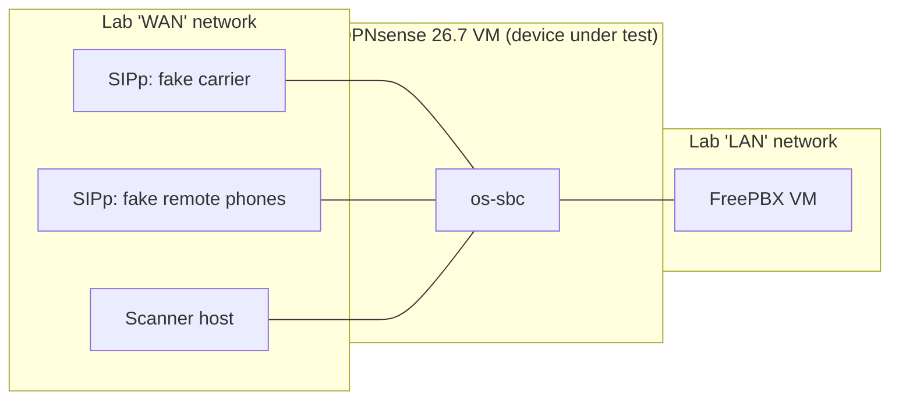

# TST-SBC-0001: os-sbc 1.0 test plan

> **In short:** Every requirement in PRD-SBC-0001 is proven by at least one
> test. Quick checks run on every pull request; full call tests run in the
> lab on every release candidate; and before each final release we place real
> calls over the Flowroute test number through the HA backup firewall.

## How testing is layered

| Level | Where it runs | When | What it catches |
|---|---|---|---|
| **Static** (`L`) | GitHub, Linux | Every PR | Syntax and style errors, leaked secrets, broken doc IDs |
| **Template** (`T`) | GitHub, Linux | Every PR | Settings that render a broken or unsafe Kamailio config |
| **Build** (`B`) | GitHub, FreeBSD VM | Every PR | Packaging mistakes |
| **Integration** (`I`) | Lab Proxmox: OPNsense VM, FreePBX VM, SIPp | Nightly on `next`, every release candidate | Calls, registrations, media, teardown, HA, capacity |
| **Security** (`S`) | Lab | Each beta and release candidate | Floods, scanners, password guessing |
| **Carrier** (`C`) | HA backup firewall + Flowroute | By hand before each final tag | What only a real carrier and real NAT show |

## The lab



Everything lives on lab Proxmox on private networks, so automated tests never
touch the real internet. VMs are rebuilt from templates for each run (Packer,
as in freenas-proxmox-packer).

**Carrier tests** use the HA backup firewall. Prepare it first with
[RB-SBC-0002](../runbooks/RB-SBC-0002-prepare-ha-backup-for-testing.md), and
restore it afterwards. Carrier calls cost money and touch production
hardware, so they never run automatically.

## What must pass, and when

| Gate | Must pass |
|---|---|
| Every PR to `next` | All `L`, `T`, `B` tests |
| 1.0.0-alpha.1 | Plus the integration tests for its requirements |
| 1.0.0-alpha.2 | Plus monitoring tests |
| 1.0.0-beta.1 | Plus security, HA and capacity tests |
| Release candidate | Everything above, on the RC package from the `testing` track |
| Final tag | RC set plus all carrier tests |

A failing test blocks the gate unless the release notes list it as a known
issue with an issue number.

## Test data rules

- Fixtures live in `tests/fixtures/` (OPNsense config snippets, recorded
  Kamailio replies) and `tests/sipp/` (one scenario per test where possible).
- No real phone numbers, credentials or carrier addresses in fixtures. Use
  documentation ranges (192.0.2.0/24, 198.51.100.0/24, 203.0.113.0/24).

## Machine-readable

Authoritative test register. Test IDs are local to this plan; outside the
repo, refer to the requirement a test proves. `tools/check_docs.py` checks
that every `proves` entry exists and that every `must` requirement is covered.

```yaml
tests:
  # Static, template and build (every PR)
  - {id: L-ALL, level: static, proves: [], title: "php -l, phpcs, xmllint, shellcheck, ruff, actionlint, gitleaks, tools/check_docs.py"}
  - {id: T-SVC-1, level: template, proves: [FR-SBC-SVC-0001], title: "configd actions and rc.conf.d render for enabled and disabled"}
  - {id: T-CFG-1, level: template, proves: [FR-SBC-SVC-0002], title: "every fixture renders and passes kamailio -c"}
  - {id: T-CFG-2, level: template, proves: [FR-SBC-NET-0001], title: "listen lines match the chosen interfaces"}
  - {id: T-CFG-3, level: template, proves: [FR-SBC-NET-0002], title: "advertise present only when an advertised address is set"}
  - {id: T-CFG-4, level: template, proves: [FR-SBC-PBX-0001], title: "PBX phone port and trunk port rendered"}
  - {id: T-CFG-5, level: template, proves: [FR-SBC-TRK-0001], title: "two trunks, one disabled: only the enabled one is routable"}
  - {id: T-CFG-6, level: template, proves: [NFR-SBC-0007], title: "hostile values in every free-text field cannot break out of the config (threat THR-SBC-0015)"}
  - {id: T-FW-1, level: template, proves: [FR-SBC-MEDIA-0002], title: "automatic pf rule fields for SIP and the relay range"}
  - {id: T-MON-1, level: template, proves: [FR-SBC-MON-0001, FR-SBC-MON-0002], title: "live-view helper parses recorded dlg.list and stats replies"}
  - {id: B-1, level: build, proves: [FR-SBC-PKG-0001], title: "os-sbc package builds on FreeBSD 15.1"}

  # Integration (lab)
  - {id: I-SVC-1, level: integration, proves: [FR-SBC-SVC-0001], title: "start, stop, restart and status from the API",
     pass_when: "status follows each action; both daemons running or stopped as expected"}
  - {id: I-SVC-2, level: integration, proves: [FR-SBC-SVC-0002], title: "invalid config refused",
     pass_when: "apply reports the kamailio -c error and the previous config keeps running"}
  - {id: I-NET-1, level: integration, proves: [FR-SBC-NET-0001], title: "SIP answered on WAN and LAN addresses only"}
  - {id: I-NET-2, level: integration, proves: [FR-SBC-NET-0002], title: "SDP and Via carry the advertised address"}
  - {id: I-NET-3, level: integration, proves: [FR-SBC-NET-0003], title: "register and call over UDP and over TCP"}
  - {id: I-REG-1, level: integration, proves: [FR-SBC-REG-0001], title: "phone registers through the SBC",
     pass_when: "phone gets 401 then 200; the PBX contact shows Path with received="}
  - {id: I-REG-2, level: integration, proves: [FR-SBC-REG-0002], title: "PBX calls a registered phone behind NAT",
     pass_when: "phone rings; RTP both ways; BYE from either side works"}
  - {id: I-REG-3, level: integration, proves: [FR-SBC-REG-0002], title: "remote phone calls a PBX extension"}
  - {id: I-TRK-1, level: integration, proves: [FR-SBC-TRK-0002, FR-SBC-PBX-0001], title: "carrier INVITE to a DID",
     pass_when: "arrives on the PBX trunk port; SDP carries the SBC LAN address; RTP both ways"}
  - {id: I-TRK-2, level: integration, proves: [FR-SBC-TRK-0001], title: "outbound call routed to the trunk named in the R-URI host"}
  - {id: I-TRK-3, level: integration, proves: [FR-SBC-TRK-0002], title: "PBX dials out through the default trunk",
     pass_when: "reaches the default trunk; SDP to the carrier carries the SBC WAN address"}
  - {id: I-MED-1, level: integration, proves: [FR-SBC-MEDIA-0001], title: "two-way audio through the relay"}
  - {id: I-MED-2, level: integration, proves: [FR-SBC-MEDIA-0001], title: "teardown on BYE, CANCEL, 486 and a dropped call",
     pass_when: "rtpproxy active sessions return to 0 every time, the dropped call after the media timeout"}
  - {id: I-MED-3, level: integration, proves: [FR-SBC-MEDIA-0002], title: "automatic rule present, and gone when turned off"}
  - {id: I-MED-4, level: integration, proves: [NFR-SBC-0001, FR-SBC-MEDIA-0002], title: "idle port scan of the relay range from the WAN",
     pass_when: "nmap UDP scan shows nothing open"}
  - {id: I-MED-5, level: integration, proves: [FR-SBC-MEDIA-0003], title: "calls work with the remote rtpengine engine selected"}
  - {id: I-NEG-1, level: integration, proves: [], title: "WAN to WAN attempt (threat THR-SBC-0001)",
     pass_when: "an INVITE from a non-trunk WAN source aimed at a trunk goes to the PBX, never to the trunk"}
  - {id: I-NEG-2, level: integration, proves: [], title: "REGISTER received on the LAN gets 403"}
  - {id: I-NEG-3, level: integration, proves: [], title: "pre-loaded Route headers from the WAN are stripped"}
  - {id: I-MON-1, level: integration, proves: [FR-SBC-MON-0001, FR-SBC-MON-0002], title: "API shows N calls while N are up"}
  - {id: I-MON-2, level: integration, proves: [FR-SBC-MON-0003], title: "dashboard widget shows calls and service status"}
  - {id: I-MON-3, level: integration, proves: [FR-SBC-MON-0004], title: "SIP and media log lines appear in the log viewer"}
  - {id: I-SEC-1, level: integration, proves: [FR-SBC-SEC-0003], title: "REGISTER from outside the allow-list is dropped"}
  - {id: I-SEC-2, level: integration, proves: [FR-SBC-SEC-0004], title: "no LAN addresses in messages sent to the carrier"}
  - {id: I-SEC-3, level: integration, proves: [FR-SBC-SEC-0005], title: "register and call over TLS"}
  - {id: I-SEC-4, level: integration, proves: [FR-SBC-SEC-0007], title: "requests on the LAN side from any address but the PBX's are dropped"}
  - {id: I-MON-4, level: integration, proves: [FR-SBC-SEC-0010], title: "a user with only the read-only ACL sees live calls but cannot open or change settings"}
  - {id: I-HA-1, level: integration, proves: [FR-SBC-HA-0001], title: "settings appear on the HA peer after sync"}
  - {id: I-HA-2, level: integration, proves: [FR-SBC-HA-0002], title: "new calls work after a CARP failover"}
  - {id: I-PKG-1, level: integration, proves: [FR-SBC-PKG-0001], title: "bootstrap os-ksa-repo, plugin appears, install, upgrade"}
  - {id: I-PKG-2, level: integration, proves: [NFR-SBC-0005], title: "a v2 package in the repo is not offered to a v1 install"}
  - {id: I-PKG-3, level: integration, proves: [NFR-SBC-0005, FR-SBC-PKG-0001], title: "fresh bootstrap leaves KSA-devel off; with the opt-in marker, os-sbc from devel appears in the plugin list and installs from the UI"}
  - {id: I-PERF-1, level: integration, proves: [NFR-SBC-0002], title: "100 concurrent G.711 calls for 10 minutes, loss under 0.5 %"}
  - {id: I-PERF-2, level: integration, proves: [NFR-SBC-0003], title: "settings apply in under 10 s"}
  - {id: I-COMPAT-1, level: integration, proves: [NFR-SBC-0004], title: "full integration suite on the current OPNsense series"}
  - {id: L-DOC-1, level: static, proves: [NFR-SBC-0008], title: "signing key rotation procedure present in opnsense-repo README (checked at each release candidate)"}
  - {id: I-COV-1, level: static, proves: [NFR-SBC-0006], title: "tools/check_docs.py coverage check: every must requirement has a test"}

  # Security (lab)
  - {id: S-1, level: security, proves: [FR-SBC-SEC-0001], title: "flood from one source is banned; other sources unaffected"}
  - {id: S-2, level: security, proves: [FR-SBC-SEC-0002], title: "scanner user agents get no response"}
  - {id: S-3, level: security, proves: [FR-SBC-SEC-0006], title: "repeated wrong passwords from one WAN source get it banned; the PBX sees no further attempts",
     pass_when: "after N 401/403 replies within M minutes the source gets no response; other sources unaffected; ban expires"}
  - {id: S-4, level: security, proves: [FR-SBC-SEC-0008], title: "one WAN source cannot hold more than the configured number of concurrent calls"}
  - {id: S-5, level: security, proves: [FR-SBC-SEC-0009], title: "RTP injected at a live relay port from a third host is neither forwarded nor latched (RTP bleed)"}

  # Carrier (manual, HA backup firewall + Flowroute; prepare with RB-SBC-0002)
  - {id: C-1, level: carrier, proves: [FR-SBC-TRK-0002], title: "mobile calls the Flowroute number, answered on a LAN phone, 2 minutes two-way audio, hang up from each side"}
  - {id: C-2, level: carrier, proves: [FR-SBC-TRK-0002], title: "LAN phone dials a mobile through Flowroute, two-way audio"}
  - {id: C-3, level: carrier, proves: [FR-SBC-REG-0002], title: "remote phone on a mobile hotspot registers and calls out through Flowroute"}
  - {id: C-4, level: carrier, proves: [NFR-SBC-0001], title: "after C-1 to C-3: 0 active relay sessions and a clean WAN scan of the relay range"}
  - {id: C-5, level: carrier, proves: [], title: "DTMF (RFC 2833) into the PBX IVR works"}
```
