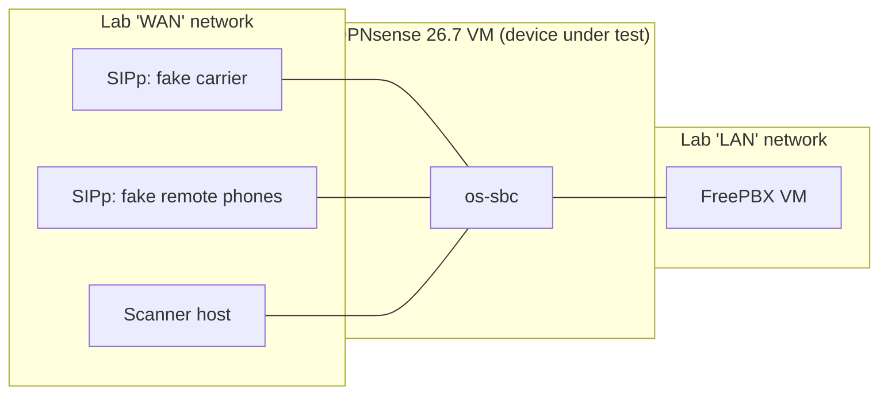

# os-sbc 1.0 test plan

**Status**: Draft
**Date**: 2026-11-26
**Related**: PRD-SBC-0001, ADR-SBC-0007, [design/DES-SBC-0001-kamailio-routing.md](../design/DES-SBC-0001-kamailio-routing.md),
[threat model](../security/threat-model.md)

Every **Must** requirement in PRD-SBC-0001 has at least one automated test
(NFR-SBC-0006). This plan says which test proves which requirement, where it runs,
and what has to pass before each milestone ships.

## 1. Test levels

| Level | ID prefix | Where | When | Tools |
|---|---|---|---|---|
| Static checks | `L-` | GitHub hosted (Linux) | Every PR | php -l, phpcs, xmllint, shellcheck, ruff, actionlint, gitleaks |
| Template and config tests | `T-` | GitHub hosted (Linux) | Every PR | OPNsense template engine with fixture configs, `kamailio -c` in a container, pytest |
| Package build | `B-` | FreeBSD 15.1 VM (hosted runner) | Every PR | opnsense/plugins `make package` |
| Integration | `I-` | Lab: OPNsense 26.7 VM + FreePBX VM + SIPp hosts | Nightly on `next`; every release candidate | SIPp, nmap, tcpdump, API calls |
| Carrier | `C-` | Second physical OPNsense firewall + Flowroute test number | Manual before every final tag | Real phones, PBX, manual checklist |
| Security | `S-` | Lab | Each beta and release candidate | SIPVicious-style scanners, SIPp floods, nmap |

## 2. Lab topology (integration)

All VMs live on lab Proxmox. The WAN side is a private lab network, so tests
never touch the real internet. Rebuilt from templates for each run (Packer,
as in freenas-proxmox-packer).

## 3. Traceability

| Requirement | Test(s) | Level |
|---|---|---|
| FR-SBC-SVC-0001 service control | T-SVC-1 configd actions render; I-SVC-1 start/stop/restart/status from API | T, I |
| FR-SBC-SVC-0002 config check | T-CFG-1 every fixture renders and passes `kamailio -c`; I-SVC-2 invalid config refused, old config keeps running | T, I |
| FR-SBC-NET-0001 interfaces | T-CFG-2 listeners match fixture; I-NET-1 SIP answered on WAN and LAN addresses only | T, I |
| FR-SBC-NET-0002 advertised address | T-CFG-3 `advertise` present when set; I-NET-2 SDP and Via carry advertised address | T, I |
| FR-SBC-NET-0003 UDP and TCP | I-NET-3 register and call over each transport | I |
| FR-SBC-PBX-0001 PBX target and trunk port | T-CFG-4; I-TRK-1 trunk calls arrive on the PBX trunk port | T, I |
| FR-SBC-TRK-0001 several trunks | T-CFG-5 two trunks, one disabled; I-TRK-2 call routed by R-URI host | T, I |
| FR-SBC-TRK-0002 inbound and outbound | I-TRK-1, I-TRK-3 outbound to default trunk; C-1, C-2 | I, C |
| FR-SBC-REG-0001 register pass-through | I-REG-1 401 then 200 relayed, Path present at PBX | I |
| FR-SBC-REG-0002 calls via NAT | I-REG-2 PBX → remote phone; I-REG-3 remote phone → PBX; C-3 | I, C |
| FR-SBC-MEDIA-0001 per-call ports | I-MED-1 audio both ways; I-MED-2 ports freed after BYE, CANCEL, 486, timeout | I |
| FR-SBC-MEDIA-0002 range and pf rule | T-FW-1 rule fields; I-MED-3 rule present and toggleable; I-MED-4 idle port scan (NFR-SBC-0001) | T, I |
| FR-SBC-MON-0001/0002 live view and load | T-MON-1 helper parses recorded `dlg.list` / stats replies; I-MON-1 API shows N calls while N are up | T, I |
| FR-SBC-SEC-0001 flood and bans | S-1 flood from one source is banned, others unaffected | S |
| FR-SBC-SEC-0002 scanners | S-2 scanner UA gets no response | S |
| FR-SBC-SEC-0003 phone allow-list | I-SEC-1 REGISTER from outside the list dropped | I |
| FR-SBC-HA-0001/0002 sync and VIP | I-HA-1 settings appear on peer; I-HA-2 new calls work after failover | I |
| FR-SBC-PKG-0001 plugin listing | B-1 package builds; I-PKG-1 `os-ksa-repo` bootstrap, plugin appears, install, upgrade | B, I |
| NFR-SBC-0002 capacity | I-PERF-1 100 concurrent G.711 calls for 10 min, no loss over 0.5 % | I |
| NFR-SBC-0003 apply time | I-PERF-2 apply under 10 s | I |
| NFR-SBC-0005 major isolation | I-PKG-2 a v2 package in the repo is not offered to a v1 install | I |

## 4. Key scenarios

### Integration (SIPp)

| ID | Scenario | Pass when |
|---|---|---|
| I-REG-1 | Phone registers through SBC | Phone gets 401 then 200; PBX contact shows Path with `received=` |
| I-REG-2 | PBX calls registered phone behind NAT | Phone rings; 200 reaches PBX; RTP both ways; BYE either side |
| I-TRK-1 | Carrier INVITE to DID | Arrives at PBX trunk port; SDP carries SBC LAN address; RTP both ways |
| I-TRK-3 | PBX dials out | Reaches the default trunk; SDP to carrier carries SBC WAN address |
| I-MED-2 | Teardown paths | After BYE, CANCEL, 486 and a dropped call (no BYE, media timeout), rtpproxy active sessions return to 0 |
| I-MED-4 | Idle port scan (NFR-SBC-0001) | nmap UDP scan of the relay range from WAN at idle shows nothing open |
| I-NEG-1 | WAN → WAN attempt | INVITE from a non-trunk WAN source with R-URI to a trunk is sent to the PBX, never to the trunk (design §1.2) |
| I-NEG-2 | REGISTER on LAN | 403 |
| I-NEG-3 | Pre-loaded Route from WAN | Route stripped; request goes to the PBX |

### Carrier (manual, Flowroute)

| ID | Scenario |
|---|---|
| C-1 | Call the Flowroute test number from a mobile; answer on a LAN phone; 2 minutes of two-way audio; hang up from each side |
| C-2 | Dial a mobile from a LAN phone through Flowroute; two-way audio; hang up |
| C-3 | Remote phone on a mobile hotspot registers and calls out through Flowroute |
| C-4 | After C-1 to C-3, rtpproxy reports 0 active sessions; WAN scan of the relay range is clean |
| C-5 | DTMF (RFC 2833) into the PBX's IVR works |

Before carrier tests: if the second firewall is an HA backup, take it out of
CARP and disable config sync. Flowroute credentials stay in the PBX and the
protected CI environment.

## 5. Fixtures

- `tests/fixtures/config/*.xml`: OPNsense config snippets (minimal, two
  trunks, TCP enabled, advertised address, rtpengine, allow-lists).
- `tests/fixtures/rpc/*.json`: recorded Kamailio JSON-RPC replies for the
  live-view parser.
- `tests/sipp/*.xml`: SIPp scenarios, one per `I-` ID where possible.
- No real phone numbers, credentials or carrier addresses in fixtures.

## 6. Entry and exit criteria

| Milestone | Must pass |
|---|---|
| Every PR to `next` | L, T, B |
| alpha.1 | I-SVC, I-NET, I-REG, I-TRK, I-MED, I-NEG, I-PKG-1 |
| alpha.2 | alpha.1 set + I-MON |
| beta.1 | alpha.2 set + S-1, S-2, I-SEC, I-HA, I-PERF |
| Release candidate | Everything above, on the RC package from `vN/testing` |
| Final tag | RC set + C-1 to C-5 |

A failed test blocks the milestone unless it is written up in the release
notes as a known issue with an issue number.
